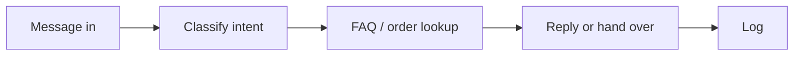

# WhatsApp Support Agent

> Answers routine customer questions in seconds from your own FAQ and order data, and hands complaints to a person with the full context.

     

**Sector:** Retail & Customer Experience  ·  **Project 8 of 50** in my [AI Automation Projects series](https://github.com/Princewill106/Princewill106)

## The problem

In Nigeria, if your business is not answering WhatsApp, you are not answering customers. Teams doing it manually reply in hours. But letting a model answer everything is worse: an agent that invents a delivery date costs more than the salary it saved.

## How it works



1. **Receive** — Messages arrive via the WhatsApp Business API webhook (`server.py`) or the demo script.
2. **Classify** — Intent is detected first: order status, price, delivery, returns, complaint or unknown. Cheap, fast, and it decides everything downstream.
3. **Answer from your content** — Known intents are answered from `faq.json` using keyword retrieval, never invented.
4. **Real data** — Order-status questions extract the order number and look it up in `orders.json`.
5. **Hand over** — Complaints and unknowns go to a human queue with the full message attached, and every handover is logged.

## Features

- Intent classification with LLM upgrade path
- Retrieval-only answers from your FAQ
- Order number extraction and lookup
- Human handover queue with context
- Minimal webhook server (`server.py`) for the WhatsApp Cloud API

## Quick start

```bash
git clone https://github.com/Princewill106/whatsapp-support-agent.git
cd whatsapp-support-agent
python main.py --demo
```

No installs needed: it uses only the Python standard library. The demo runs fully offline using the sample data in this repo.

**Optional: plug in an LLM.** Copy `.env.example` to `.env` and add an Anthropic or OpenAI key. The project will then use the model for the language-heavy steps and fall back to its rule-based logic if a call fails.

Run the tests:

```bash
python -m unittest -v
```

## Sample output

```text
[greeting    |AUTO    ] +2348031110001: Hi good morning
   -> Hi! How can we help today? You can ask about prices, delivery or your order.

[price       |AUTO    ] +2348031110002: How much are your sneakers?
   -> Our sneakers start from NGN 25,000. Full price list: https://example.com/prices

[order_status|AUTO    ] +2348031110003: Where is my order 10234?
   -> Order 10234 is out for delivery, expected today before 6pm.

[delivery    |AUTO    ] +2348031110004: Do you deliver to Abuja and how long?
   -> Outside Lagos we deliver in 3-5 working days via GIG Logistics, from NGN 6,000.

[complaint   |HANDOVER] +2348031110005: I received the wrong item and I'm not happy
   -> I'm sorry about this. I've passed your message to a member of our team, who will reply shortly.

[returns     |AUTO    ] +2348031110006: Can I exchange for a bigger size?
   -> You can exchange unworn items within 7 days. Reply with your order number to start.

[unknown     |HANDOVER] +2348031110007: Do you sell gift cards for corporate clients?
   -> I'm sorry about this. I've passed your message to a member of our team, who will reply shortly.

Answered automatically: 5/7. Handover queue -> output/handover_queue.json
```

## Use it in n8n (no code needed)

[`n8n-workflow.json`](n8n-workflow.json) is a ready-to-import n8n version of this project, built for n8n 1.x.

1. In n8n, open **Workflows → Import from File** and choose `n8n-workflow.json`.
2. Click **Test workflow**. It runs the full logic on the sample data built into the *Sample data* node, so you can see the results before connecting anything.
3. Open each output node and connect your accounts: Slack, WhatsApp (OAuth), WhatsApp Business Cloud API. For Google Sheets, pick your spreadsheet and sheet.
4. Adjust the settings at the top of the **Logic** node (thresholds, templates, contacts), then **Activate**.

**Flow:** **WhatsApp Trigger** → **Logic** (Code node) → **Route** (Switch)

**Outputs:**
- Reply on WhatsApp
- Send holding reply
- Hand over to a human (Slack)

The Logic node is a JavaScript port of the rules in `main.py`, so you can run the project in n8n without Python.

## Use it on your own data

Edit `faq.json` and connect `orders.json` to your real order source. For live use, run `python server.py`, expose it with a tunnel, and set it as your WhatsApp Cloud API webhook (set `WHATSAPP_VERIFY_TOKEN`).

## Project structure

```text
n8n-workflow.json            Importable n8n workflow
.env.example                 Optional API key settings
.gitignore                   Git ignore rules
LICENSE                      MIT license
README.md                    This file
faq.json                     Reference / config data
llm.py                       Optional LLM helper (offline fallback)
main.py                      Entry point and core logic
orders.json                  Reference / config data
requirements.txt             Dependencies (stdlib only)
sample_messages.json         Sample input data for the demo
server.py                    Supporting file
test_main.py                 Unit tests
```

## Who this is for

- Online stores selling on Instagram and WhatsApp
- Restaurants and delivery businesses
- Any SME where the same five questions arrive all day

## Ideas to extend it

- [ ] Send replies through the Cloud API
- [ ] Embeddings-based FAQ search
- [ ] Shopify/WooCommerce order lookup
- [ ] Weekly report of what the agent could not answer

## About

Built by **Ogbu Ugochukwu Princewill**, AI Automation Lead and robotics engineer. I teach people and businesses to build with AI, not just talk about it. [LinkedIn](https://www.linkedin.com/in/ugochukwu-ogbu-653a0816a)

If this helped you, give it a ⭐ and share what you built with it.

## License

MIT — see [LICENSE](LICENSE).
